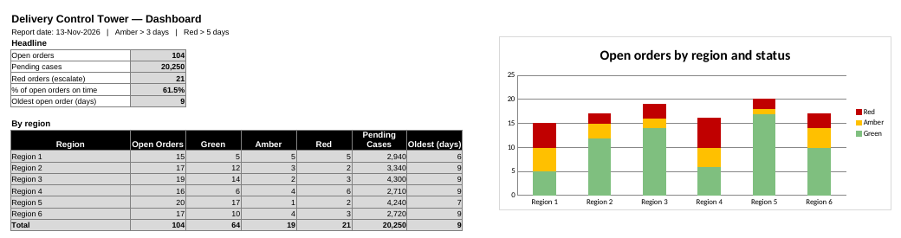

# Delivery Control Tower

> An Excel tool that tracks every pending customer order, shows how long it has waited, and flags orders at risk of late delivery.

## The problem
In a beverage distribution business serving 300+ dealers, logistics and sales teams had no single view of which orders were still pending, how long customers had waited, or where to escalate. Follow-up relied on phone calls and memory, and late deliveries were often discovered only when a customer complained.

## What I built
- **One list of all pending orders**: dealer, region and delivery type are pulled in automatically from the dealer master.
- **Automatic status flags**: each order is Green, Amber or Red by days waiting, with thresholds the user can set.
- **A management dashboard**: open orders, pending cases, Red escalations, % on time and the oldest open order, by region, with a chart.
- **A simple daily routine**: paste the pending-order export, set the report date, and the dashboard updates.

## Results (in live use)
- 313 dealers tracked in one place
- Delays escalated **before** customers complain, not after
- A daily review that fits on one screen for management

## How it works
| Sheet | Purpose |
|---|---|
| **Read Me** | Instructions and cell legend |
| **Dashboard** | Headline KPIs, regional breakdown and chart (all formulas) |
| **Settings** | Report date and Amber / Red day thresholds |
| **Dealers** | Dealer master list: ID, name, region, delivery type |
| **Orders** | Daily pending orders. Yellow = input, grey = formula |

**Cell convention:** 🟨 yellow cells are inputs · ⬜ grey cells are formulas (do not edit).

**Key logic**
- `Days Waiting` = Delivered Date − Order Date, or Report Date − Order Date if not yet delivered
- `Status` = Delivered / Red (over the Red threshold) / Amber (over the Amber threshold) / Green
- Dashboard built with `COUNTIFS`, `SUMIFS`, `MAXIFS` and `INDEX/MATCH`; no macros needed

## Files
| File | Description |
|---|---|
| `Delivery_Control_Tower_SAMPLE.xlsx` | Working tool with 60 sample dealers and 150 sample orders |
| `dashboard.png` | Dashboard screenshot |

## Tools used
Excel · COUNTIFS / SUMIFS / MAXIFS · INDEX-MATCH · data validation · conditional formatting · charts

---
*All data in this repository is fictional and for demonstration only.*
*Built by [Kingsley Udolisa](https://github.com/kingsley-udolisa).*
